# Acceso a Datos · RA1 · <Pablo Gamero Ávila>

**Temática:** Gestión de la Clase de 2º de DAM (alumnos, módulos, notas, actas y asistencia)  
**Entorno:** JDK 21 · IntelliJ IDEA · JUnit 6.1.3 · Maven

## Cómo ejecutar el proyecto y las pruebas

1. Abre la carpeta del proyecto como proyecto Maven en IntelliJ IDEA: `File > Open > pom.xml > Open as Project` (**JDK 21**).
2. Pulsa el icono **«m»** (*Load Maven Changes*) para descargar las dependencias de JUnit.
3. Ejecuta la clase principal `ad.ra1.app.Main` con el *Working directory* apuntando a la raíz del proyecto (donde se encuentran `datos/` y `xslt/`) y utiliza el menú interactivo (`1` a `7`).
4. Para ejecutar la batería de pruebas unitarias: haz clic derecho sobre `src/test/java` y selecciona `Run 'All Tests'` (o `More Run/Debug > Run 'All Tests' with Coverage` para ver la cobertura).

El programa utiliza únicamente la biblioteca estándar de Java 21; JUnit es la única dependencia externa (ámbito `test`). Los ficheros temporales de ejecución se guardan en `salida/` (excluida de Git en `.gitignore`).

---

## a) Ficheros y directorios

Para gestionar la estructura de carpetas del curso de **2º de DAM** (`clase_2dam`, subdirectorios `informes/2026` y fichas de módulos/alumnos) se ha implementado la clase [`GestorFicheros.java`](src/main/java/ad/ra1/ficheros/GestorFicheros.java) empleando la API **`java.nio.file` (NIO.2)** mediante `Path` y `Files`.

### Operaciones implementadas y decisiones técnicas
* **Creación, copia y movimiento (`crearDirectorio`, `copiar`, `mover`):** Construcción de rutas portables mediante `Path.of` y `.resolve()`, respetando el flag de sobrescritura (`StandardCopyOption.REPLACE_EXISTING`).
* **Listado, búsqueda y metadatos (`listar`, `buscar`, `buscarRecursivo`, `describir`, `tamanoTotal`):** Uso de `Files.list` y `Files.walk` dentro de bloques `try-with-resources` para garantizar el cierre de los descriptores de directorio del sistema operativo.
* **Borrado recursivo seguro (`eliminarRecursivo`):** Emplea `Files.walkFileTree` con un `SimpleFileVisitor` para eliminar primero los ficheros hoja y después los directorios vacíos en `postVisitDirectory`.
* **Prevención de *Path Traversal* (`resolverSeguro`):** Normaliza tanto el directorio base como la ruta solicitada (`toAbsolutePath().normalize()`) y verifica con `startsWith` que no escape de la carpeta permitida (bloqueando rutas como `../../examen_secreto.txt`).

### Evidencias
* **Estructura creada antes del borrado:** 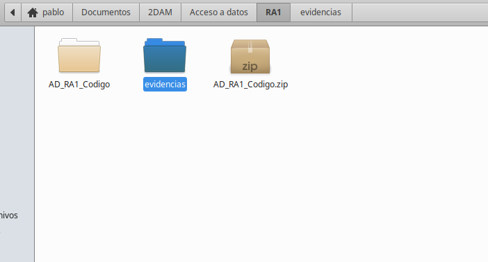
* **Directorio limpiado tras `eliminarRecursivo`:** 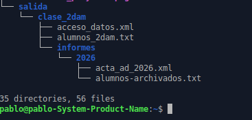
* **Salida de consola:** 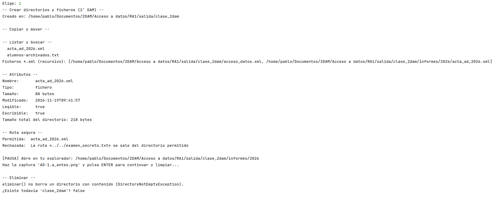

---

## b) Formas de acceso

En [`AccesoFicheros.java`](src/main/java/ad/ra1/ficheros/AccesoFicheros.java) se han implementado tres mecanismos de acceso sobre el modelo [`AlumnoDam.java`](src/main/java/ad/ra1/modelo/AlumnoDam.java):
1. **Texto secuencial (`leerCsv`):** Lectura línea a línea con `BufferedReader` del fichero `datos/alumnos_2dam.csv` y conversión a objetos `AlumnoDam`.
2. **Binario secuencial (`escribirBinario` / `leerBinario`):** Volcado compacto mediante `DataOutputStream` y `DataInputStream` con registros de longitud fija de **96 bytes** (`id` 4 B + `nombre` 40 B + `modulo` 40 B + `notaMedia` 8 B + `horasFaltas` 4 B).
3. **Binario de acceso aleatorio (`leerRegistro` / `actualizarHorasFaltas`):** Uso de `RandomAccessFile` y `seek(indice * 96 + 92)` para consultar y modificar directamente las horas de falta de un alumno concreto sin reescribir el resto del archivo.

### Tabla comparativa de formas de acceso

| Forma de acceso | Ventajas | Inconvenientes | Cuándo usarla |
| :--- | :--- | :--- | :--- |
| **Texto secuencial (`BufferedReader` / `Files.lines`)** | Legible por humanos, portable entre sistemas, bajo consumo de RAM al leer línea a línea con búfer. | Lento para buscar un dato concreto (obliga a recorrer desde el principio) y ocupa más espacio en disco. | Logs de actividad, importación/exportación de listados CSV de alumnos y ficheros de configuración. |
| **Texto completo en memoria (`Files.readAllLines`)** | Código muy corto y cómodo; permite acceso indexado en RAM (`get(i)`). | Puede provocar un `OutOfMemoryError` si el fichero crece mucho (varios cientos de MB o GB). | Ficheros pequeños de texto que necesiten procesarse varias veces en memoria. |
| **Binario secuencial (`DataInputStream` / `DataOutputStream`)** | Compacto en disco, rápido y guarda tipos primitivos de Java (`int`, `double`) sin necesidad de parsear texto. | No es legible directamente con un editor de texto y sigue obligando a leer de principio a fin. | Volcados masivos de datos numéricos, copias de seguridad internas o intercambio rápido entre programas Java. |
| **Binario de acceso aleatorio (`RandomAccessFile`)** | Permite saltar directamente a cualquier registro en tiempo constante $O(1)$ usando `seek(indice * TAM_REGISTRO)` y modificar campos sueltos sin reescribir todo el fichero. | Obliga a definir registros de longitud fija (desperdiciando bytes de relleno `\0` en cadenas cortas) y es complejo insertar o borrar registros en mitad del archivo. | Bases de datos sencillas de tamaño fijo donde se consultan y actualizan registros puntuales por posición (p. ej., actualizar las faltas de un alumno de 2º DAM). |

### Mediciones del Benchmark (200.000 líneas, 11,5 MB)
* `BufferedReader (línea a línea)`: **30 ms** (mediana)
* `Files.readAllLines (todo a memoria)`: **29 ms** (mediana)
* `Files.lines (stream)`: **22 ms** (mediana)
* `Scanner.nextLine`: **55 ms** (mediana)

### Elección para el proyecto y límites de la medición
* **Forma elegida:** Para la gestión de la clase de **2º de DAM** se combina el **acceso secuencial de texto (CSV/XML)** para la carga inicial e intercambio legible de listados, con el **acceso binario aleatorio (`RandomAccessFile`)** para el control diario de asistencia. Al tener cada registro de `AlumnoDam` una longitud fija de **96 bytes**, podemos actualizar las faltas de un alumno en tiempo constante mediante `seek` sin reescribir todo el fichero.
* **Por qué la medición no es definitiva:** Los tiempos de `BenchmarkLectura` son solo orientativos y no equivalen a un banco de pruebas profesional (como JMH). En ellos influyen la **caché de páginas del sistema operativo** (tras la primera lectura, el fichero queda en RAM), la **compilación JIT (*Just-In-Time*)** y el recolector de basura de la JVM, además de la carga puntual del equipo.

### Evidencias
* **Acceso secuencial y aleatorio (`RandomAccessFile`):** 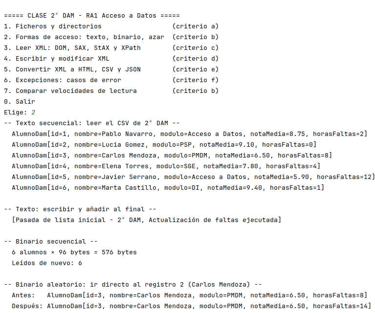
* **Salida del Benchmark:** 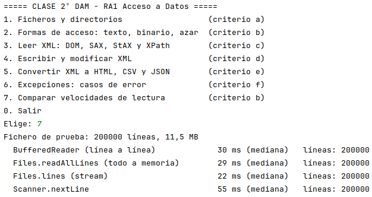

---

## c) Leer XML

En [`LectorXml.java`](src/main/java/ad/ra1/xml/LectorXml.java) se lee el fichero [`datos/clase_2dam.xml`](datos/clase_2dam.xml) (6 alumnos con atributo `id`, elementos hijos y el carácter especial `&amp;` escapado en `Sistemas &amp; Gestión Empresarial`) mediante tres técnicas distintas (**DOM**, **SAX** y **StAX**) y dos consultas **XPath** (`/clase/@fecha` y `/clase/alumno[number(notaMedia) > $min]` con variable segura). Todas las fábricas se obtienen desde [`XmlSeguro.java`](src/main/java/ad/ra1/xml/XmlSeguro.java), que deshabilita `DOCTYPE` y entidades externas para prevenir ataques **XXE**.

### ¿Qué técnica elegiría para un fichero XML de 2 GB y por qué?
Para procesar un fichero XML de **2 GB** elegiría **StAX (`XMLStreamReader`)** (o alternativamente **SAX**), descartando por completo **DOM** y **XPath**. El motivo es que DOM construye el árbol completo de nodos en la memoria RAM (un XML de 2 GB puede ocupar entre 6 y 10 GB en memoria como objetos Java), provocando un **`OutOfMemoryError`**. En cambio, **StAX** es un analizador basado en flujo (*pull parser*) que lee el documento secuencialmente etiqueta a etiqueta con un consumo de memoria mínimo y constante, permitiendo además detener la lectura en cuanto se encuentra el dato buscado.

### Evidencia
* **Lectura con DOM, SAX, StAX y consultas XPath:** 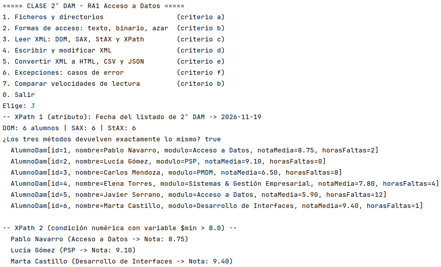

---

## d) Escribir XML

En [`EscritorXml.java`](src/main/java/ad/ra1/xml/EscritorXml.java) se ha implementado la generación completa del XML tanto con **DOM** (`escribirAlumnosConDom`) como al vuelo con **StAX** (`escribirAlumnosConStax`), además de operaciones de alta (`anadirAlumno`), modificación (`actualizarFaltasAlumno`) y borrado (`eliminarAlumno`) gestionando identificadores duplicados e inexistentes.

* **Escapado automático:** Al construir el documento mediante nodos DOM y eventos StAX (nunca concatenando cadenas), caracteres especiales como `&`, `<` y `"` (por ejemplo en `Sofía "La Pro" & Cía <2DAM>`) se escapan automáticamente (`&amp;`, `&lt;`, `&quot;`).
* **Escritura atómica:** Todas las escrituras se vuelcan primero en un fichero temporal `.part` junto al destino y lo sustituyen con `ATOMIC_MOVE`, evitando archivos corruptos si ocurre un fallo a mitad de escritura.

### Evidencias
* **XML generado abierto en el IDE con caracteres escapados:** 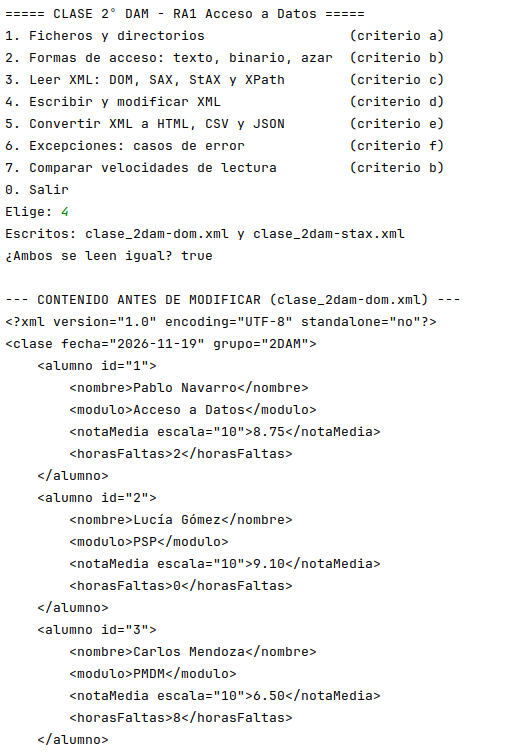
* **Consola antes y después de añadir, modificar y eliminar:** 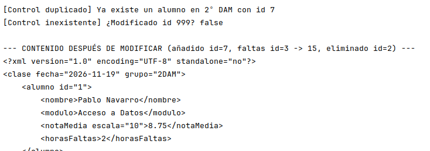

---

## e) Convertir XML

Mediante [`ConversorXml.java`](src/main/java/ad/ra1/xml/ConversorXml.java) se transforma `datos/clase_2dam.xml` a tres formatos de salida:
1. **HTML** ([`xslt/clase_2dam-html.xsl`](xslt/clase_2dam-html.xsl)): Genera una tabla ordenada de mayor a menor por `notaMedia` con formato condicional en rojo para notas bajas (`< 6.5`) o faltas elevadas (`>= 10`).
2. **CSV** ([`xslt/clase_2dam-csv.xsl`](xslt/clase_2dam-csv.xsl)): Exporta el listado tabular con cabecera y separador `;`.
3. **JSON** (`alumnosAJson`): Lee con StAX y serializa a JSON escapando comillas, barras invertidas y caracteres de control (`escaparJson`).

### ¿Cuándo usaría cada formato de salida?
* **HTML:** Cuando el destinatario final es una persona (por ejemplo, un tutor o jefe de estudios) que necesita consultar visualmente un informe o boletín de notas ordenado y con alertas resaltadas directamente en cualquier navegador web.
* **CSV:** Para exportar listados tabulares planos que vayan a abrirse en hojas de cálculo (Excel, LibreOffice Calc) o importarse masivamente en otras herramientas por su ligereza y sencillez.
* **JSON:** Para integrar los datos en aplicaciones web modernas, aplicaciones móviles o APIs REST, ya que es el estándar nativo de JavaScript, resulta más compacto que XML y conserva la estructura jerárquica y los tipos de datos.

### Evidencias
* **Informe HTML abierto en el navegador:** 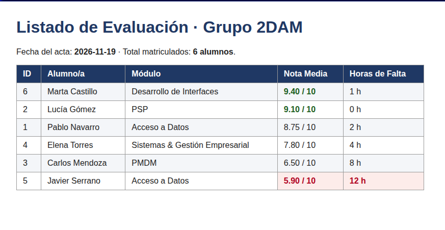
* **Ficheros CSV y JSON generados:** 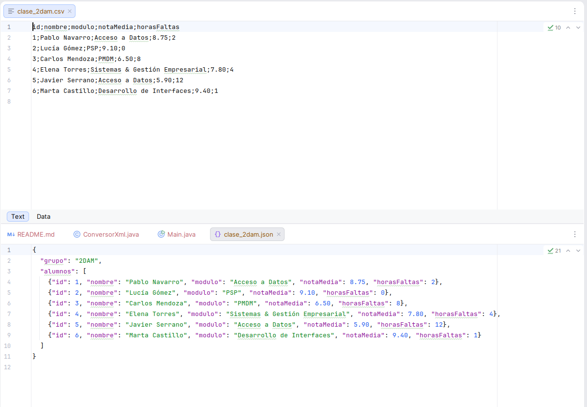

---

## f) Excepciones

Se ha creado la excepción propia [`ClaseDamException.java`](src/main/java/ad/ra1/servicio/ClaseDamException.java) (con mensaje claro para el usuario y causa técnica encadenada) y la capa de servicio [`ServicioClaseDam.java`](src/main/java/ad/ra1/servicio/ServicioClaseDam.java), que centraliza todos los bloques `catch`, registra el detalle técnico con `java.util.logging.Logger` y oculta al usuario las rutas completas del sistema mostrando únicamente el nombre del archivo.

### Casos de error y mensajes traducidos

| Caso de error probado | Fichero de prueba | Excepción técnica capturada | Mensaje mostrado al usuario |
| :--- | :--- | :--- | :--- |
| Fichero inexistente | `no-existe-2dam.xml` | `NoSuchFileException` | `No existe el fichero «no-existe-2dam.xml».` |
| Fichero ya existente | `duplicado_prueba.xml` | `FileAlreadyExistsException` | `El fichero «duplicado_prueba.xml» ya existe y no se ha sobrescrito.` |
| XML mal formado | `clase_2dam-malformado.xml` | `SAXParseException` / `XMLStreamException` | `El XML de «clase_2dam-malformado.xml» no está bien formado o no está permitido (línea 6, columna 7).` |
| XML con `DOCTYPE` (XXE) | `clase_2dam-peligroso.xml` | `SAXException` | `El contenido XML de «clase_2dam-peligroso.xml» no es válido o contiene elementos prohibidos.` |
| Número con formato incorrecto | `clase_2dam-nota-erronea.xml` | `NumberFormatException` | `Hay un valor numérico con formato incorrecto en «clase_2dam-nota-erronea.xml».` |
| Datos no válidos / ID repetido | `clase_2dam.xml` | `IllegalArgumentException` | `Datos no válidos en «clase_2dam.xml»: Ya existe un alumno en 2º DAM con id 1` |

### ¿Por qué se ordenan así los bloques `catch` y qué ocurriría si se cambiara el orden?
En Java, los bloques `catch` se evalúan secuencialmente de arriba abajo y se ejecuta **el primero** cuyo tipo coincida con la excepción lanzada o sea superclase suya. Por ello deben ordenarse **de las excepciones más específicas (subclases) a las más generales (superclases)**: `NoSuchFileException` y `FileAlreadyExistsException` antes que `IOException`; `SAXParseException` (que aporta línea y columna) antes que `SAXException`; `NumberFormatException` antes que `IllegalArgumentException`; y `Exception` en último lugar.

Si se cambiara el orden poniendo una superclase antes que sus subclases, el compilador de Java **produciría un error de compilación** (*«exception ... has already been caught»*), ya que los bloques específicos inferiores quedarían como código inalcanzable (*unreachable code*).

### Evidencias
* **Consola con todos los casos de error controlados (Parte 1):** 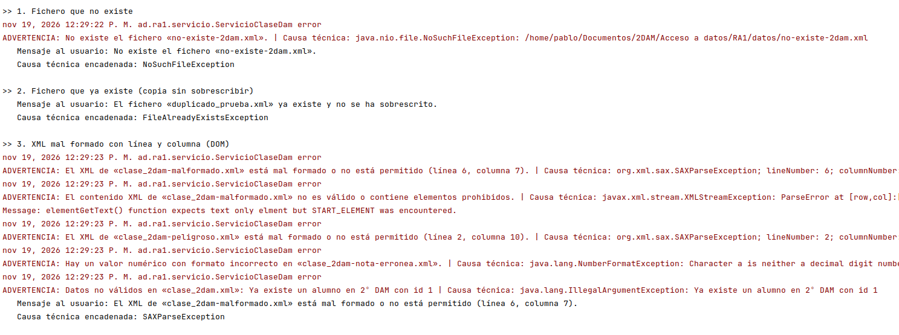
* **Consola con todos los casos de error controlados (Parte 2):** 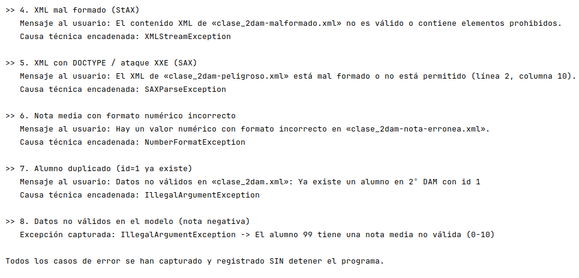

---

## g) Pruebas y documentación

Se han desarrollado **51 pruebas unitarias** con JUnit 6 en [`src/test/java/ad/ra1/`](src/test/java/ad/ra1/) (`GestorFicherosTest`, `AccesoFicherosTest`, `LectorXmlTest`, `EscritorXmlTest`, `ConversorXmlTest` y `ServicioClaseDamTest`), utilizando `@TempDir` en todas las pruebas que escriben en disco.

### Plan de pruebas

| ID | Clase probada | Caso de prueba | Entrada / Acción | Resultado esperado | Estado |
| :--- | :--- | :--- | :--- | :--- | :--- |
| **CP-01** | `GestorFicheros` | Borrado recursivo de directorios con contenido | `eliminarRecursivo(base)` sobre carpeta con subdirectorios y archivos | Elimina los archivos hoja y las carpetas sin lanzar `DirectoryNotEmptyException` | Superado |
| **CP-02** | `GestorFicheros` | Prevención de *Path Traversal* | `resolverSeguro(base, "../fuera.txt")` | Lanza `IllegalArgumentException` al detectar salida del directorio base | Superado |
| **CP-03** | `AccesoFicheros` | Validación de columnas al leer CSV | `leerCsv` con una fila de 4 columnas en lugar de 5 | Lanza `IllegalArgumentException` indicando el número de línea | Superado |
| **CP-04** | `AccesoFicheros` | Modificación puntual por acceso aleatorio | `actualizarHorasFaltas(fichero, 1, 15)` | Modifica únicamente los 4 bytes de faltas del registro 1 sin alterar el tamaño | Superado |
| **CP-05** | `LectorXml` | Equivalencia entre DOM, SAX y StAX | Lectura de `datos/clase_2dam.xml` con los 3 analizadores | Los 3 devuelven la misma lista de 6 `AlumnoDam` con `&amp;` decodificado | Superado |
| **CP-06** | `LectorXml` | Consulta XPath con variable numérica | `filtrarPorNotaMinima(xml, 8.0)` usando `$min` | Devuelve los 3 alumnos cuya nota media supera 8.00 | Superado |
| **CP-07** | `EscritorXml` | Escapado de caracteres especiales XML | `escribirAlumnosConDom` con `&`, `<` y `"` en el texto | Escribe `&amp;`, `&lt;` y `&quot;` y el XML resultante se lee sin errores | Superado |
| **CP-08** | `EscritorXml` | Rechazo de identificador duplicado | `anadirAlumno` con `id=1` ya existente | Lanza `IllegalArgumentException` y conserva intacto el fichero | Superado |
| **CP-09** | `ConversorXml` | Conversión XSLT a HTML y CSV + JSON | `transformar` con hojas `.xsl` y `alumnosAJson` | Genera tabla HTML ordenada, CSV con cabecera `;` y JSON válido | Superado |
| **CP-10** | `ServicioClaseDam` | Bloqueo XXE y ocultación de rutas | Carga de `clase_2dam-peligroso.xml` con `<!DOCTYPE>` | Rechaza el `DOCTYPE` y lanza `ClaseDamException` mostrando solo el nombre del fichero | Superado |

### Cobertura y generación de Javadoc
* **Porcentaje de cobertura obtenido:**
  * `ad.ra1.modelo`: ___ % líneas
  * `ad.ra1.ficheros`: ___ % líneas
  * `ad.ra1.xml`: ___ % líneas
  * `ad.ra1.servicio`: ___ % líneas
* **Cómo generar Javadoc:** En IntelliJ IDEA, ir a `Tools > Generate JavaDoc...`, seleccionar como directorio de salida `docs/javadoc` y pulsar `Generate` (o ejecutar `mvn javadoc:javadoc`).

### Evidencias
* **Todas las pruebas JUnit en verde:** 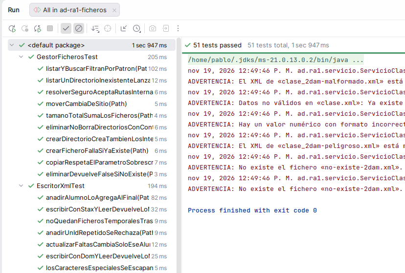
* **Informe de cobertura de código:** 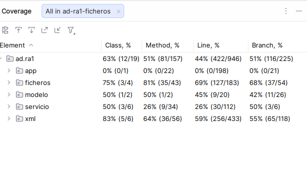
* **Documentación Javadoc abierta en el navegador:** 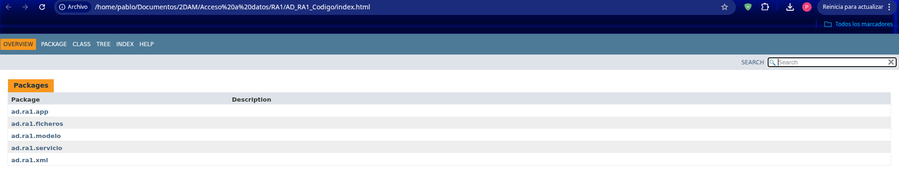